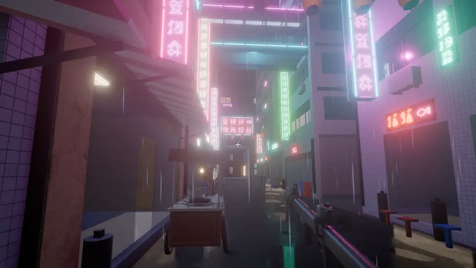
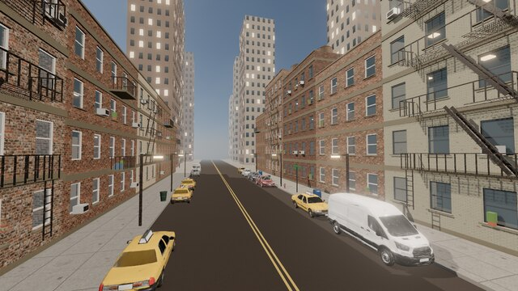
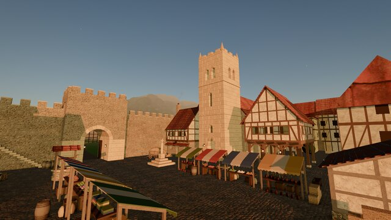
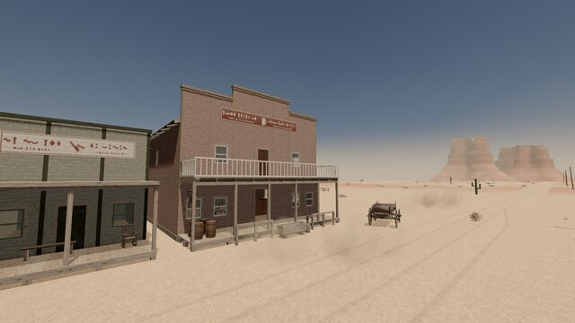
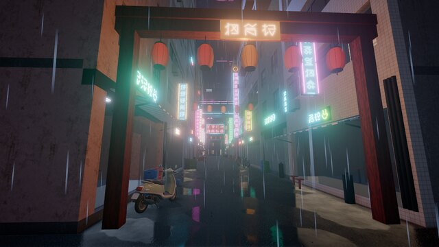
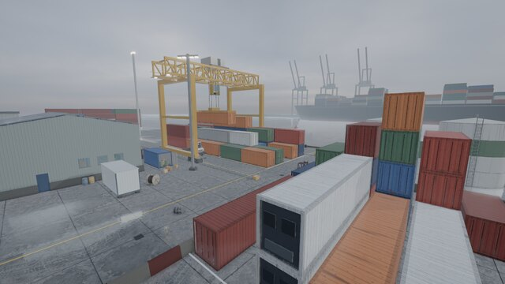
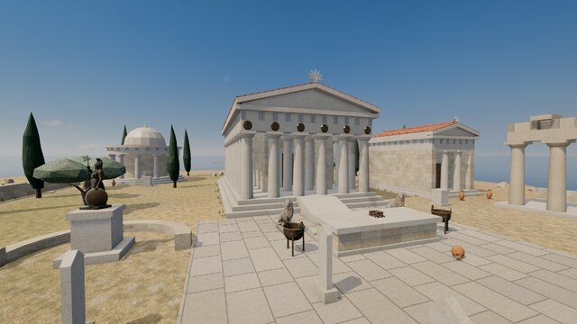

<div align="center">

# Breakable.js

**Real-time destruction for Three.js, on the GPU.**

Buildings that stand under their own weight, and come down when it fails.

[Play it](https://kchernev.github.io/breakable.js/) · [Showreel](https://github.com/kchernev/breakable.js/releases/tag/showreel) · [Library](docs/library.md) · [Make a world](docs/making-a-world.md)



</div>

## What it does

- **Fracture.** A blast cuts what it reaches into Voronoi cells, small at the hit and larger further
  off. Wood splits along its grain, glass shatters, metal bends.
- **Collapse.** Every piece's weight is traced down through what it rests on. What loses its
  support falls as whole sections, tipping over the edge it hangs past.
- **Bullets.** Rounds chip and dent what they strike until it gives way where it was hit.
- **Breakable ground.** Roads, squares, sand and earth crater under rockets, and sustained fire
  digs into them.
- **Sound.** A spatial Web Audio engine turns every break, knock, landing and rumble into sound.
- **Cheap when still.** Standing pieces cost the solver nothing, so a whole town of 6,000–8,000
  pieces stays interactive. Rubble that comes to rest freezes again.

Built on WebGPU and [three-avbd](https://github.com/sbobyn/three-avbd)'s GPU rigid-body solver.

## Six worlds to break

<table>
<tr>
<td width="33%" valign="top"><a href="src/demo/worlds/nyc/"></a><br /><b>Brick Street</b><br /><sub>New York walk-ups whose facades peel into the street.</sub></td>
<td width="33%" valign="top"><a href="src/demo/worlds/medieval/"></a><br /><b>Market Town</b><br /><sub>A market square at golden hour, a church tower and its bell.</sub></td>
<td width="33%" valign="top"><a href="src/demo/worlds/western/"></a><br /><b>Dust Town</b><br /><sub>Saloons, a water tower and a windmill at high noon.</sub></td>
</tr>
<tr>
<td valign="top"><a href="src/demo/worlds/neon/"></a><br /><b>Neon Alley</b><br /><sub>A rain-soaked alley of neon signs that die when shot.</sub></td>
<td valign="top"><a href="src/demo/worlds/harbor/"></a><br /><b>Harbor Yard</b><br /><sub>Container stacks, a gantry crane and fuel tanks in the fog.</sub></td>
<td valign="top"><a href="src/demo/worlds/temple/"></a><br /><b>Sun Temple</b><br /><sub>A marble sanctuary on a hilltop above the sea.</sub></td>
</tr>
</table>

Each world reacts to what you do. Birds take off, alarms go off, and what you shoot leaks, rings,
sparks or goes dark.

## Quick start

```sh
pnpm install
pnpm dev        # http://127.0.0.1:5330
```

You need a browser with WebGPU, such as Chrome or Edge. On Linux, `pnpm chrome` opens the demo with
WebGPU switched on ([why](docs/development.md#running-it)).

| Key | Action |
|---|---|
| **Click** | Fire. Hold the button for the machine gun. |
| **1** / **2** / **Wheel** | Rocket launcher / machine gun |
| **WASD**, **Shift**, **Space** | Move, run, jump |
| **F** | Fly |
| **M** · **R** · **Esc** | Sound · rebuild · pick a world |

## Use it

```ts
import { World } from 'three-avbd';
import { Destruction, groundPresets, presets } from 'breakable.js';

const world = await World.create({ renderer, maxBodies: 60_000 });
const destruction = new Destruction({
  world,
  scene,
  materials: {
    brick: presets.brick(),
    concrete: presets.concrete(),
    asphalt: groundPresets.asphalt(),
    earth: groundPresets.earth(),
  },
});

// Build from boxes and convex hulls. Pieces that touch face to face are bonded.
destruction.addGround({ material: 'asphalt', under: 'earth', area: [-20, -6, 20, 6] });
destruction.addBox({ material: 'brick', size: [3, 3, 0.3], position: [0, 1.5, 0] });
destruction.addBox({ material: 'concrete', size: [3.2, 0.25, 2], position: [0, 3.125, 0.85] });
destruction.reinforce();

// Break it
destruction.explode({ at: [0, 1.5, 0.3], radius: 2 });
destruction.shoot(muzzle, direction);

renderer.setAnimationLoop(() => {
  world.update(dt);
  destruction.update(dt);
  renderer.render(scene, camera);
});
```

## Docs

| Guide | What's in it |
|---|---|
| [Library](docs/library.md) | The API, sound and props, how it works inside, the solver |
| [Making a world](docs/making-a-world.md) | The world contract, what stands and how it breaks, the asset pipelines |
| [Developing](docs/development.md) | Running and testing, WebGPU on Linux, GitHub Pages, the project layout |
| [Assets and credits](docs/assets.md) | How the sounds, textures and models were made, the raw sources, credits |
| [Changelog](docs/changelog/) | What changed in each phase, and how it was measured |

## Credits

The solver is [three-avbd](https://github.com/sbobyn/three-avbd) by Steven Bobyn (MIT), an
implementation of Augmented Vertex Block Descent (Giles, Diaz, Yuksel, SIGGRAPH 2025). Skies and
photographed textures are from [Poly Haven](https://polyhaven.com) (CC0). The sounds, the other
textures and the models were generated for this project with Stable Audio 3, GPT Image 2.5, Tripo
and Meshy, and finished by script and in Blender. [Every asset is credited here](docs/assets.md#credits).

## License

MIT
